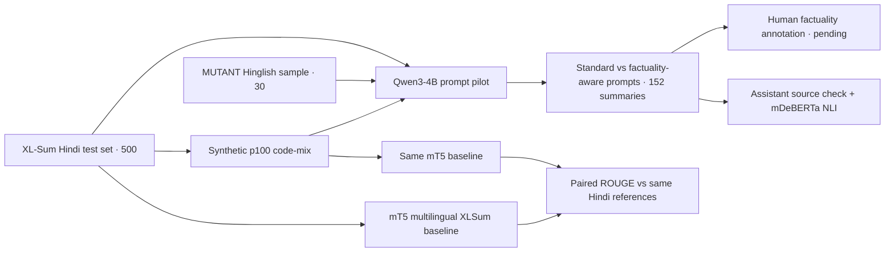

# FactIndic — Interim Project Report

**Status:** computational and automated-screening stages are documented; human factuality annotation has not been completed. This report is suitable for an interim project checkpoint, not a factuality-performance claim.

## Project question

Does a factuality-aware instruction change Hindi summary quality for Hindi, synthetically code-mixed, and naturally code-mixed sources?

The project separates lexical-overlap evaluation from factuality. ROUGE results compare summaries with references; assistant review and multilingual NLI provide exploratory screening; only a genuine human review can support human factuality labels.

## Workflow

The two automated checks are screening aids. Neither produces human gold labels.

## Data, models, and method

- **Hindi baseline:** 500 XL-Sum Hindi test articles summarized with the `csebuetnlp/mT5_multilingual_XLSum` checkpoint.
- **Synthetic code-mixing:** the same 500 article IDs with p050/p100 perturbations. The paired p100 comparison scores both outputs against the same Hindi references.
- **Authentic code-mixing:** 30 MUTANT passages in the prompt pilot. A provenance scan matched 47 of 50 local candidate passages to one upstream file; 3 remained ambiguous. Within the pilot, 28/30 map uniquely and 2 are ambiguous. Original publisher/event URLs were not available in the dataset files.
- **Prompt pilot:** Qwen3-4B, greedy generation, 512-token source budget; standard and factuality-aware instructions on the same source within each condition. The quality-filtered pilot has 76 source documents and 152 summaries: Hindi 23 pairs, synthetic p100 23 pairs, MUTANT 30 pairs. Seven Hindi/synthetic pairs were excluded symmetrically after generation-quality failures.
- **Automated factuality screening:** a preliminary assistant source-check pass and `MoritzLaurer/mDeBERTa-v3-base-mnli-xnli`. NLI entailment/contradiction values are not calibrated factuality probabilities. FactCC informed the planned checking approach; its English model was not used.

## Results

### Paired Hindi vs synthetic p100 baseline

| Metric | Hindi ROUGE F1 | Synthetic p100 ROUGE F1 | p100 − Hindi | 95% paired bootstrap interval |
|---|---:|---:|---:|---:|
| ROUGE-1 | 37.24 | 35.53 | −1.71 | [−2.47, −0.96] |
| ROUGE-2 | 16.79 | 15.24 | −1.55 | [−2.28, −0.84] |
| ROUGE-L | 31.20 | 29.82 | −1.38 | [−2.07, −0.69] |

The synthetic p100 summaries had lower lexical overlap with the original Hindi references in this sample. This is not evidence of a factuality decline or a result about authentic Hinglish. Hindi inputs were marked truncated in 364/500 cases and p100 inputs in 355/500; truncation status matched for 491/500 pairs.

### Assistant-only source checks

Across 152 summaries, the preliminary assistant labels were 107 supported, 19 minor-error flags, and 26 major-error flags. Supported flags were 49/76 for the standard arm and 58/76 for the factuality-aware arm. Among the 45 flagged rows, the assistant taxonomy recorded 13 relation errors, 13 unsupported additions, 5 date errors, 5 entity errors, 3 attribution errors, 2 number errors, 2 polarity errors, and 2 other errors. The assistant review was unblinded to prompt condition; these are triage labels, not verified correctness rates.

### Multilingual NLI screen

The clean-source re-score includes all 152 summaries, 76 matched prompt pairs, zero displayed source markers, and zero hypothesis truncations. Mean max-entailment was 0.8572; median was 0.9980, showing strong ceiling saturation. Paired mean differences (factuality-aware minus standard) were +0.0920 for authentic MUTANT, −0.0353 for Hindi, and −0.0025 for synthetic p100. Median differences were close to zero in every condition. Contradiction differences changed direction by condition. These results do not identify an overall prompt winner.

The initial source display had terminal U+FFFD markers in 28 rows. A separate cleaned display copy removed only those terminal markers; no missing character was guessed. A row-by-row re-score comparison found every NLI probability and all chunk/token indices identical to the earlier run. Only the stored source-chunk text changed in the 28 affected rows.

## Software verification

The local unit-test suite passes: 38 tests passed in 0.89 seconds. This validates the project’s existing data, metric, baseline-runner, code-mix, and rule-check components; it does not execute or verify GPU model inference.

## What can be claimed now

- The 500-item Hindi and synthetic p100 baseline runs are complete and paired by article ID.
- Synthetic p100 has lower ROUGE overlap against the Hindi references in this sample.
- The 152-summary prompt pilot is balanced by condition and prompt arm, with documented symmetric exclusions.
- Automated assistant and NLI signals vary by condition and do not support a reliable prompt winner.
- The clean-source NLI re-score passed row-level input and output checks.

## What cannot be claimed yet

- Human-verified factuality, factuality accuracy, or an overall factuality winner.
- General performance beyond the selected datasets and pilot sample.
- That synthetic code-mixing represents natural Hinglish.
- Original event/news-source provenance for MUTANT passages beyond the upstream dataset file matches.

## Remaining work

1. If factuality claims are required, complete the 152-row blinded human worksheet. Keep the private unblinding key separate until labels are complete. Do not fill human fields from assistant/NLI predictions.
2. With one annotator, report single-annotator limitations; a second annotator is needed to estimate agreement.
3. After annotation, unblind, summarize labels by condition and prompt, compute paired movements and error types, then revise the presentation.
4. If no human annotation is feasible, present the current work explicitly as an exploratory AI-only checkpoint.

## Reproducibility files

- Paired baseline method/results: `results/paired_baseline_comparison.md`
- Updated assistant-only prompt report: `results/ai_only_prompt_pilot_summary_2026-11-13.md`
- Clean-source NLI re-score and audit: `results/prompt_pilot_nli_rescore_2026-11-13/`
- Assistant attention queue: `results/prompt_pilot_review_candidate_2026-11-09/assistant_review_attention_queue_2026-11-13.csv`
- MUTANT provenance method and limits: `results/mutant_source_provenance_audit_2026-11-13.md`
- Current teacher deck: `FactIndic_Progress_Checkpoint_2026-11-13_NLI_rescored.pptx`
- Supervisor brief PDF: `results/factindic_checkpoint_for_maam_2026-11-13.pdf`
